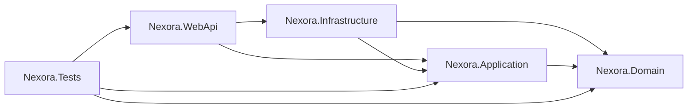

# Nexora Backend - Project Context

> Đây là tài liệu context dành cho người phát triển và các cuộc trò chuyện mới với AI.
> Hãy đọc file này trước khi phân tích hoặc thay đổi backend. Tài liệu mô tả trạng thái
> code hiện tại, không phải toàn bộ roadmap tương lai.

## 1. Tổng quan

Nexora Backend là ASP.NET Core Web API cho hệ thống Nexora AI. Backend hiện tập trung
vào các nhóm chức năng quản trị hệ thống:

- Authentication: login, refresh token, logout và current user.
- User management.
- Role management.
- Role → ApiFunction permission management.
- ApiFunction catalog và CRUD.
- Organization management.
- Department và Department membership.
- Document upload và MVP RAG indexing: MinIO, text extraction/OCR, chunking, embedding và Qdrant.

Domain model đã có thêm các nhóm cho Project, Document, RAG, Chat, Meeting, Task và
Calendar. Tuy nhiên, trong trạng thái hiện tại chưa có controller/API đầy đủ cho tất cả
các nhóm này.

Định hướng triển khai hiện tại là một Organization về mặt nghiệp vụ. Schema và một số
luồng cũ vẫn giữ `OrganizationId` và `OrganizationRoleAssignment` để tương thích dữ liệu
và authorization model hiện có.

## 2. Công nghệ và solution

| Thành phần | Công nghệ / vị trí |
|---|---|
| Runtime | .NET 10, target framework `net10.0` |
| API | ASP.NET Core Web API |
| Architecture | Layered/Clean Architecture kết hợp CQRS-style feature slices |
| Mediator | MediatR |
| Validation | FluentValidation qua MediatR pipeline behavior |
| Database | PostgreSQL |
| ORM | Entity Framework Core 10 + Npgsql |
| Identity | ASP.NET Core Identity với `Guid` key |
| Authentication | JWT Bearer access token + database-backed refresh token |
| API documentation | Swagger/OpenAPI với Swashbuckle |
| Rate limiting | Built-in ASP.NET Core Rate Limiting, sliding window |
| Container | Docker multi-stage build, .NET 10 images |
| CI/CD | GitLab CI, build/push image lên Docker Hub |
| Tests | xUnit, project `tests/Nexora.Tests` |
| RAG storage | MinIO cho file gốc/chunk content, Qdrant cho vector index |

Solution file: `Nexora.sln`.

```text
src/Nexora.Domain          Domain entities, value objects, enums, invariants
src/Nexora.Application     Commands, queries, handlers, DTOs, validators, abstractions
src/Nexora.Infrastructure   EF Core, PostgreSQL, Identity, JWT, repositories, migrations
src/Nexora.WebApi           Controllers, middleware, responses, composition root
tests/Nexora.Tests          Unit/domain/application/web middleware tests
```

Dependency direction:



## 3. Quy tắc tổ chức code

Application được tổ chức theo feature:

```text
src/Nexora.Application/Features/V1/SystemManagements/{Feature}/
  Command/
  Query/
  Model/
  Validation/
```

Các command thay đổi state thường implement `ITransactionalCommand<T>`. Các query
implement `IQuery<T>`. `MediatR` dispatch request từ controller đến handler.

Pipeline behavior hiện có:

1. `ValidationBehavior`: chạy tất cả FluentValidation validator; lỗi validation ném
   `ValidationException`.
2. `TransactionBehavior`: chỉ mở transaction cho `ITransactionalCommand<T>`. Nếu result
   thất bại thì không gọi `SaveChangesAsync`; nếu thành công thì lưu thay đổi trong cùng
   transaction.

Application không truy cập trực tiếp `DbContext`. Application dùng các abstraction như
`IUnitOfWork`, repository interfaces, `IUserContext`, `IClock` và
`IDefaultOrganizationProvider`.

## 4. Web request pipeline

Thứ tự chính trong `src/Nexora.WebApi/Program.cs`:

```text
UseExceptionHandler
UseStatusCodePages
UseHttpsRedirection
UseSwagger / UseSwaggerUI
UseRouting
UseAuthentication
UseRateLimiter
JwtAuthenticationMiddleware
ApiPermissionMiddleware
MapControllers
```

CORS chỉ cho phép các frontend origin sau:

```text
http://192.168.123.3:3000
http://localhost:3000
```

`AllowedHosts` là danh sách Host của API (`192.168.123.3` và `localhost`), không phải
frontend origin và không chứa scheme/port.

### Response envelope

API dùng envelope chung `ApiResponse<T>`:

```json
{
  "success": true,
  "statusCode": 200,
  "message": "...",
  "data": {},
  "meta": {
    "timestamp": "...",
    "path": "/api/...",
    "requestId": "..."
  }
}
```

Lỗi dùng `error.code` và có thể có `error.details`:

```json
{
  "success": false,
  "statusCode": 400,
  "message": "...",
  "error": {
    "code": "validation.error",
    "details": []
  },
  "meta": {}
}
```

`GlobalExceptionHandler` map các lỗi chính:

- `ValidationException` → `400` và `validation.error`.
- `DomainException` → `422` với domain error code.
- `UnauthorizedAccessException` → `403` và `authorization.forbidden`.
- `DbUpdateConcurrencyException` → `409` và `concurrency.conflict`.
- Lỗi chưa xử lý → `500` và `server.error`.

## 5. Authentication

### Endpoints

```text
POST /api/auth/login
POST /api/auth/refresh
POST /api/auth/logout
GET  /api/auth/me
```

`AuthController` dùng `ControllerBase`, không kế thừa `BaseController`, vì vậy login và
refresh không đi qua custom authentication middleware. Rate limit vẫn được áp dụng bằng
attribute trên action.

### Login flow

```text
LoginRequest
  -> LoginCommand
  -> ValidateCredentialsAsync
  -> AuthTokenService.IssueAsync
  -> tạo access token + refresh token
  -> GetEffectiveByUserAsync
  -> AuthMapper.ToResponse
  -> ApiResponse<AuthResponse>
```

Response login/refresh có các trường:

- `userId`
- `email`
- `tokenType`
- `accessToken`
- `accessTokenExpiresAt`
- `refreshToken`
- `refreshTokenExpiresAt`
- `apiFunctions`: các ApiFunction hiệu lực của user, không phải toàn bộ catalog.

`GetEffectiveByUserAsync` lọc theo:

- Organization hiện tại/mặc định.
- User đang có role assignment hiệu lực.
- Role đang active.
- Grant chưa revoke.
- `ValidFrom` đã đến và `ExpiresAt` chưa hết hạn.
- ApiFunction đang active.
- `DENY` loại trừ quyền `ALLOW` cùng Function.

Trong query hiện tại, việc lấy effective ApiFunction không kiểm tra
`OrganizationMembership`; quyền được suy ra từ user, role assignment và role grant.

## 6. RAG document upload MVP

Các API đã triển khai:

```text
POST /api/documents
GET  /api/documents/{documentId:guid}
GET  /api/documents/{documentId:guid}/status
```

Upload dùng `multipart/form-data` field `file`. Web API tạo metadata trong các bảng
`document.Documents` và `document.DocumentVersions`, lưu file gốc vào MinIO rồi đưa
version vào in-memory `BackgroundService` queue.

Worker xử lý TXT/MD, DOCX và PDF. PDF được đọc bằng `pdftotext`; PDF scan rỗng text
layer sẽ đi qua OCRmyPDF + Tesseract với ngôn ngữ `vie+eng`. Nội dung được chia chunk,
lưu vào `DocumentChunks`/`DocumentChunkContents`, embedding được upsert vào Qdrant và
metadata vector được lưu trong `RagIndexes`/`RagIndexRecords`. Trạng thái thành công là
`READY`, lỗi là `FAILED`.

API không nhận `OrganizationId` từ client. `OrganizationId` vẫn được lấy server-side
để tương thích schema hiện tại của domain/database một Organization. Chi tiết cấu hình
và lệnh kiểm tra nằm ở `docs/rag-upload.md`.

### JWT và refresh token

JWT access token chứa các claim chính:

```text
sub             UserId
organizationId  Organization mặc định
jti             Refresh token id
tokenType       ACCESS
roleId          Role hiệu lực được chọn, nếu có
```

`AuthTokenService`:

- Lấy Organization từ `IDefaultOrganizationProvider`.
- Mặc định access token sống 15 phút.
- Mặc định refresh token sống 30 ngày.
- Chỉ lưu hash của refresh token trong database.
- Rotate refresh token khi refresh.
- Revoke token cũ sau khi rotate.
- Phát hiện refresh token reuse và revoke các refresh token liên quan.
- Revoke token khi logout hoặc user bị deactivate.

Các giá trị này được cấu hình qua `JwtOptions` và được validate khi ứng dụng khởi động.
Signing key phải có ít nhất 32 ký tự.

## 6. Authorization model

Luồng dữ liệu quyền hiện tại:

```text
User
  -> OrganizationRoleAssignment
  -> ApplicationRole / Role
  -> RoleApiFunction
  -> ApiFunction
```

`OrganizationRoleAssignment` là bảng cũ dùng để gán Role cho User trong một Organization.
API đồng bộ permission mới không nhận `UserId`, không tạo bảng UserApiFunction và không
ghi quyền trực tiếp lên User. API mới chỉ cập nhật `RoleApiFunction` cho Role.

### Role → ApiFunction bulk permission API

```http
PUT /api/roles/{roleId}/permissions
```

Request:

```json
{
  "functionIds": [
    "api-function-id-1",
    "api-function-id-2"
  ]
}
```

Application contract:

```csharp
SyncRolePermissionsCommand(Guid RoleId, IReadOnlyCollection<Guid> FunctionIds)
RolePermissionsResponse(Guid RoleId, IReadOnlyCollection<Guid> FunctionIds)
```

Handler hiện thực hiện:

1. Yêu cầu actor đã đăng nhập.
2. Lấy Organization mặc định từ server-side provider.
3. Kiểm tra Role tồn tại và active.
4. Loại bỏ Function ID trùng và sort danh sách.
5. Kiểm tra Function tồn tại và active.
6. Load toàn bộ grant của Role trong Organization ở trạng thái tracking.
7. Grant mới được tạo với `ALLOW`.
8. Grant `DENY`, revoke hoặc hết hạn được regrant thành `ALLOW` khi Function được gửi lại.
9. Function bị loại khỏi request được revoke, không hard delete.
10. Toàn bộ thay đổi chạy trong transaction.

Validation hiện có:

- `RoleId` không được rỗng.
- `FunctionIds` không null và tối đa 1000 phần tử.
- Từng Function ID không được `Guid.Empty`.

Các endpoint permission khác:

```http
PUT    /api/roles/{roleId}/permissions/{functionCode}
DELETE /api/roles/{roleId}/permissions/{functionCode}
GET    /api/roles/{roleId}/permissions
PUT    /api/roles/{roleId}/permissions
```

### ApiFunction catalog

Catalog được khai báo trong `SyncApiFunctionCatalogCommandHandler` và có script seed tại
`scripts/seed-api-functions.sql`. Hiện catalog có 46 route definitions cho Auth, User,
Role, Authorization, Department và Organization.

`ApiFunctionCode` tự normalize code về uppercase. Vì vậy code trong handler có thể viết
lowercase nhưng database/SQL seed lưu dạng uppercase.

Catalog phải đồng nhất theo cặp:

```text
HTTP method + route template
```

Route template được lưu dạng canonical, ví dụ:

```text
/api/roles/{roleId:guid}/permissions
```

## 7. Custom authorization middleware - trạng thái hiện tại

`ControllerSecurityMetadata` chỉ coi controller là cần custom security khi controller kế
thừa `BaseController`.

Hiện tại:

| Controller | Kế thừa `BaseController` | Custom JWT/permission middleware |
|---|---:|---:|
| `AuthController` | Không | Bỏ qua |
| `UserController` | Không | Bỏ qua |
| `RoleController` | Không | Bỏ qua |
| `OrganizationController` | Không | Bỏ qua |
| `ApiFunctionController` | Có | Đi qua |
| `DepartmentController` | Có | Đi qua |

Đây là điểm cần kiểm tra trước khi thay đổi authorization. `JwtAuthenticationMiddleware`
chỉ trả `401` cho controller có `BaseController`. `ApiPermissionMiddleware` lấy HTTP
method và route template từ endpoint rồi gọi `IApiRequestPermissionChecker`.

> Trong code hiện tại, `ApiPermissionService` đang xác minh ApiFunction catalog active theo
> HTTP method + route template. Nó chưa trực tiếp tính effective RoleApiFunction grant cho
> request middleware. Phần tính effective grant hiện được dùng trong login/refresh để trả
> về `apiFunctions`. Không nên mặc định rằng mọi endpoint đã được enforce đầy đủ quyền
> Role → ApiFunction nếu chưa kiểm tra lại service này.

## 8. Rate limiting

Đăng ký tại `RateLimitConfiguration` và gọi từ `Program.cs` bằng
`AddNexoraRateLimiting()`.

Chính sách:

- Sliding window 1 phút.
- 6 segments mỗi window.
- `QueueLimit = 0`, request vượt quota bị từ chối ngay.
- Global limiter hiện partition theo `UserId` nếu có, nếu không thì theo IP.
- Policy `auth`: 10 request/phút/IP.
- Policy `write`: 30 request/phút theo UserId nếu authenticated, nếu không theo IP.
- Response vượt quota là HTTP `429`.
- Có header `Retry-After`.
- Error code: `rate_limit.exceeded`.

Các action hiện gắn policy:

- Login, refresh: `auth`.
- Logout: `write`.
- POST/PUT/DELETE/action ghi trên User, Role, ApiFunction, Department và Organization:
  `write`.
- GET không gắn `write`, chỉ chịu limiter global hiện tại.

> Rate limit lưu in-memory trong process. Khi restart hoặc chạy nhiều instance, quota
> không phải distributed quota.

## 9. Database và persistence

`NexoraDbContext` kế thừa `IdentityDbContext<ApplicationUser, ApplicationRole, Guid>`.
Các schema chính:

```text
identity       ASP.NET Identity users, roles, claims, tokens
organization   Organization, membership, role assignment, departments, profiles
security       ApiFunctions, RoleApiFunctions, AccessTokens, ActivityLogs
project        Project và project memberships/documents
document       Folders, Documents, Versions, AccessGrants, Chunks
rag            RagIndexes, records, retrieval runs/hits
chat           Conversations, messages, AI turns, citations
meeting        Meetings và participants
task           Tasks
calendar       CalendarEvents
```

`HasQueryFilter` dùng `ITenantContext.OrganizationId` cho các entity có OrganizationId.
Một số service gọi `IgnoreQueryFilters()` khi cần truy vấn assignment/grant hoặc lấy
Organization mặc định.

`SaveChanges`/`SaveChangesAsync` tự động cập nhật:

- `CreatedAt` khi entity mới.
- `UpdatedAt` và `UpdatedByUserId`.
- `RowVersion` khi entity mới hoặc update.
- `DeleteBy` khi soft delete.

Migrations hiện có:

```text
20260805142907_InitialPostgresSchema
20260809134903_AddIdentityLifecycle
20260809143604_AddApiFunctionRouteLookupIndex
```

Không tự động apply migration production trong CI/CD nếu chưa có quy trình triển khai
database riêng.

## 10. Configuration và secrets

Configuration quan trọng:

```text
ConnectionStrings:Postgres
Company:DefaultOrganizationId
Jwt:Issuer
Jwt:Audience
Jwt:SignaturePrivateKey hoặc Jwt:SecretKey
Jwt:AccessTokenMinutes
Jwt:RefreshTokenDays
```

Có thể map bằng environment variables:

```text
ConnectionStrings__Postgres
Company__DefaultOrganizationId
Jwt__Issuer
Jwt__Audience
Jwt__SignaturePrivateKey
Jwt__AccessTokenMinutes
Jwt__RefreshTokenDays
```

Không commit password PostgreSQL, JWT signing key, Docker Hub token hoặc secret khác vào
repository. `appsettings.Production.json` hiện dùng placeholder cho PostgreSQL; giá trị
thật phải được cung cấp từ secret manager hoặc environment.

## 11. Docker

`Dockerfile` ở root dùng multi-stage build:

```text
base     ASP.NET Core runtime .NET 10, non-root user, ports 8080/8081
build    .NET SDK .NET 10, restore và build WebApi
publish  dotnet publish, UseAppHost=false
final    chỉ copy output publish và chạy Nexora.WebApi.dll
```

Build context phải là thư mục root của backend:

```bash
docker build -t nexora-webapi .
docker run -p 8080:8080 -p 8081:8081 nexora-webapi
```

`.dockerignore` loại bỏ `bin`, `obj`, `.git`, `.vs`, các file environment và Docker
compose khỏi build context.

## 12. GitLab CI/CD và Docker Hub

File `.gitlab-ci.yml` có hai stage:

### `verify`

Chạy bằng image `mcr.microsoft.com/dotnet/sdk:10.0` với restore, build và test tuần tự
(`-m:1`) để ổn định trên môi trường hiện tại.

### `build_and_push_image`

Chạy Docker-in-Docker bằng Docker 24.0.5 và push lên Docker Hub. GitLab variables bắt
buộc:

```text
DOCKERHUB_USERNAME
DOCKERHUB_TOKEN
```

`DOCKERHUB_REPOSITORY` mặc định là `nexora-webapi` và có thể override trong GitLab.

Image được push:

- Commit trên default branch: `username/nexora-webapi:<short-sha>` và `latest`.
- Tag đúng SemVer có prefix `v`, ví dụ `v1.0.0`: `username/nexora-webapi:v1.0.0`.
- Tag không khớp `vX.Y.Z` không chạy job push image.

Ví dụ release:

```bash
git tag -a v1.0.0 -m "Release v1.0.0"
git push origin v1.0.0
```

Docker-in-Docker runner phải hỗ trợ `privileged` mode.

## 13. API catalog hiện tại

Các nhóm route có trong catalog:

| Module | Prefix |
|---|---|
| Auth | `/api/auth` |
| User | `/api/users` |
| Role | `/api/roles` |
| Authorization | `/api/api-functions` |
| Department | `/api/departments` |
| Organization | `/api/organizations` |

Khi thêm hoặc thay đổi endpoint cần cập nhật đồng bộ:

1. Controller route và HTTP method.
2. `SyncApiFunctionCatalogCommandHandler`.
3. `scripts/seed-api-functions.sql`.
4. Permission/authorization tests.
5. CI hoặc tài liệu API nếu contract thay đổi.

## 14. Testing

Test project: `tests/Nexora.Tests/Nexora.Tests.csproj`.

Nhóm test hiện có:

- Domain authentication.
- Domain authorization và DENY/ALLOW policy.
- Organization/domain rules.
- Value objects.
- Transaction behavior.
- API response envelope.
- JWT authentication middleware.
- API permission middleware.
- Rate limit configuration/policy.

Lệnh kiểm tra chuẩn:

```bash
dotnet restore Nexora.sln -m:1
dotnet build Nexora.sln --configuration Release --no-restore -m:1
dotnet test tests/Nexora.Tests/Nexora.Tests.csproj --configuration Release --no-build --no-restore -m:1
```

Nếu build trên Windows bị lock output hoặc lỗi `CS2012`, ưu tiên build tuần tự với
`-m:1`, kiểm tra process `Nexora.WebApi` và dùng output path riêng khi cần. Không dừng
hoặc reset thay đổi của người dùng để xử lý lỗi build.

## 15. Các điểm cần nhớ khi bắt đầu task mới

- Đọc file này và kiểm tra `git status` trước khi sửa.
- Không giả định `OrganizationMembership` là điều kiện bắt buộc của effective permission
  nếu task đang theo luồng một Organization hiện tại.
- Phân biệt rõ ba việc: gán Role cho User, cấp ApiFunction cho Role và enforce request.
- Không tạo `UserApiFunction`; quyền trực tiếp User → ApiFunction không thuộc thiết kế
  hiện tại.
- Khi làm permission, kiểm tra cả `OrganizationRoleAssignment`, `RoleApiFunction`,
  `ApiFunction.Status`, validity window, `RevokedAt` và DENY-over-ALLOW.
- Khi làm authentication, kiểm tra cả login và refresh response.
- Khi làm endpoint mới, cập nhật API catalog và seed script.
- Khi làm CI/CD, không ghi secret vào YAML; dùng GitLab protected/masked variables.
- Chỉ sửa code khi người dùng yêu cầu rõ ràng; với yêu cầu phân tích thì không tự ý
  implement.

## 16. Tài liệu và file bắt đầu đọc

```text
Nexora.sln
src/Nexora.WebApi/Program.cs
src/Nexora.Infrastructure/DependencyInjection.cs
src/Nexora.Infrastructure/Persistence/NexoraDbContext.cs
src/Nexora.Infrastructure/Authentication/AuthTokenService.cs
src/Nexora.Infrastructure/Authorization/ApiPermissionService.cs
src/Nexora.Application/Features/V1/SystemManagements/Auth/
src/Nexora.Application/Features/V1/SystemManagements/Role/
src/Nexora.Application/Features/V1/SystemManagements/Authorization/
src/Nexora.WebApi/Middleware/
src/Nexora.WebApi/RateLimiting/
Dockerfile
.gitlab-ci.yml
scripts/seed-api-functions.sql
tests/Nexora.Tests/
```
