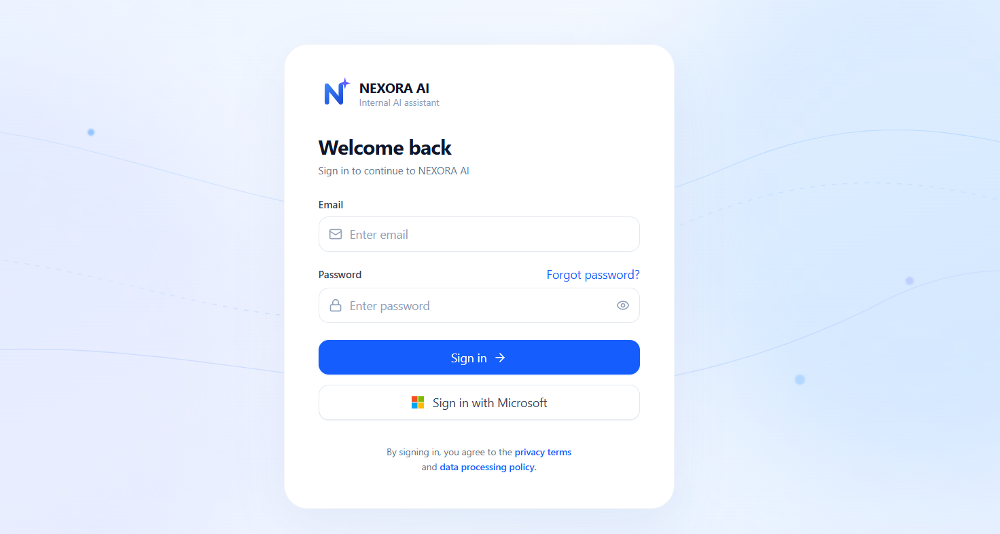
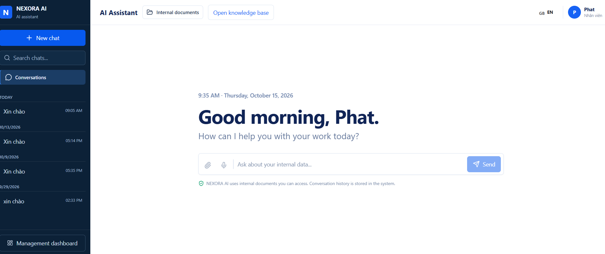
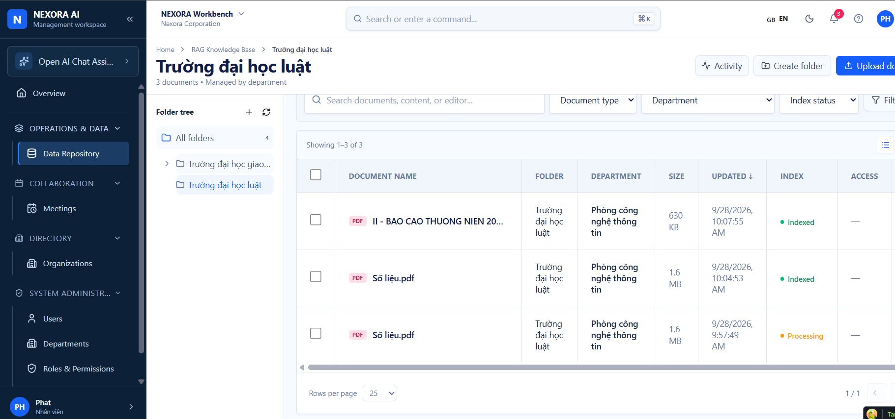
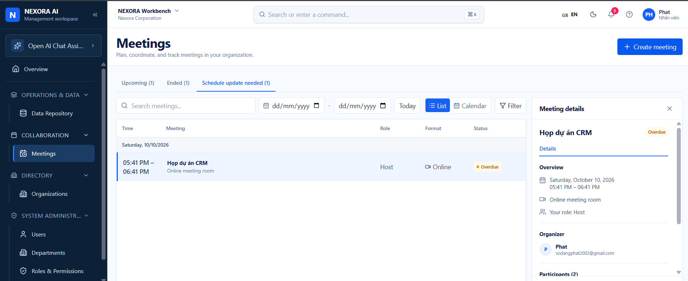
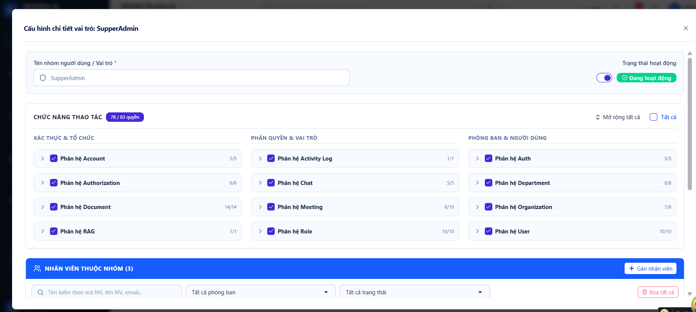

# Nexora AI

Nexora AI là dự án nghiên cứu về quản lý tri thức, trợ lý AI và cộng tác trong tổ chức.

## Chức năng chính

| Thành phần | Mô tả |
| --- | --- |
| Trợ lý AI | Hội thoại, tìm kiếm tri thức từ tài liệu được phép truy cập và hiển thị nguồn tham khảo cho câu trả lời. |
| Kho tài liệu | Quản lý thư mục, tải tài liệu lên, trích xuất nội dung và lập chỉ mục để tìm kiếm. |
| Không gian quản trị | Quản lý tổ chức, phòng ban, người dùng, vai trò và quyền truy cập. |
| Cuộc họp | Tạo, theo dõi và tham gia cuộc họp trực tuyến qua LiveKit; hỗ trợ transcript lời nói bằng tiếng Việt và tiếng Anh. |
| Nền tảng | ASP.NET Core Web API, PostgreSQL, MinIO, Qdrant và React/TypeScript. |

## Giao diện minh họa

### Đăng nhập



### Trợ lý AI



### Kho tài liệu



### Cuộc họp



### Quản lý vai trò và quyền



## Cài đặt bằng Docker

Cần Docker Compose. Đặt repository backend này và [repository frontend](https://github.com/phatvo2002/RAG_Frontend) cạnh nhau; frontend cần có `Dockerfile` ở thư mục gốc:

```text
workspace/
├── my_rag-backend/
└── my_rag-frontend/
```

Từ thư mục `workspace`, tải frontend và tạo `.env` trong backend:

```sh
git clone https://github.com/phatvo2002/RAG_Frontend.git my_rag-frontend
cd my_rag-backend
cp .env.example .env
```

`.env` chỉ chứa credential, khóa mã hóa và chuỗi kết nối PostgreSQL. Điền các giá trị chính:

| Biến | Cách điền |
| --- | --- |
| PostgreSQL | Khi chạy WebApi từ Visual Studio hoặc `dotnet run`, đặt `ConnectionStrings__Postgres` tới database trên máy (ví dụ `Host=127.0.0.1;Port=5432;Database=Nexora_AI_V2`). Khi chạy bằng Compose trên Docker Desktop, đặt `COMPOSE_POSTGRES_CONNECTION_STRING` tới cùng database nhưng dùng `Host=host.docker.internal` để container truy cập máy chủ. |
| MinIO | `Storage__AccessKey`/`Storage__SecretKey` phải khớp `MINIO_ROOT_USER`/`MINIO_ROOT_PASSWORD`. |
| Khóa máy chủ | Điền `Jwt__SignaturePrivateKey` (ít nhất 32 ký tự). Tạo **hai khóa Base64 32 byte khác nhau** cho `ProviderKeys__EncryptionKeyBase64` và `Chat__EncryptionKeyBase64` ([cách tạo khóa](docs/personal-provider-keys.md)). |
| AI và cuộc họp | `Embedding__ApiKey` cho Gemini Embedding; `LiveKit__Url`, `LiveKit__ApiKey` và `LiveKit__ApiSecret` khi dùng phòng họp; `MeetingAgent__ApiKey` là khóa riêng cho worker transcript. |

`.env` không được đưa lên Git. Cổng, đường dẫn dữ liệu, endpoint và URL local nằm trong `docker-compose.yml`; khi chạy WebApi trực tiếp, endpoint và provider mặc định nằm trong `src/Nexora.WebApi/appsettings.json`. API key Gemini/Claude cho chat được từng người dùng thêm trong trang **Tài khoản**; `Qdrant__ApiKey` có thể để trống nếu Qdrant không bật xác thực.

Hệ thống chỉ dùng `gemini-embedding-001` ở **768 chiều**. Index mới dùng collection `nexora_documents_gemini_001`, tách khỏi vector của model cũ. Worker lập chỉ mục tối đa **5 chunk mỗi batch**, chờ ít nhất **35 giây** sau mỗi batch; cả truy vấn chat và tài liệu dùng chung giới hạn **24 đầu vào trong 60 giây** trên một tiến trình WebApi. Khi API trả 429, worker chờ rồi thử lại. Tiến độ của tài liệu có quyền xem nằm ở tab **Hoạt động → Tiến trình xử lý** và `GET /api/documents/progress`. Sau khi khởi động lại, worker tiếp tục các chunk chưa có bản ghi index.

Tài liệu mới được chia bằng `SemanticChunker.NET` 1.5.0. Cấu hình `DocumentProcessing:ChunkingMode` mặc định là `Semantic`; đặt thành `Fixed` để dùng lại cách chia theo ký tự. Semantic dùng cửa sổ câu `SemanticBufferSize=1`, ngưỡng `SemanticBreakpointPercentile=95` và `SemanticTokenLimit=320`, sau đó giới hạn mỗi chunk ở `ChunkSizeCharacters=1200`. Chế độ Fixed vẫn dùng `ChunkOverlapCharacters=200`. Chunk lưu ở MinIO, metadata ở PostgreSQL và vector ở Qdrant. Giao diện nhận excerpt tối đa 600 ký tự; ngữ cảnh gửi LLM dùng toàn bộ chunk. Các tài liệu đã xử lý không tự đổi cách chia: xóa và tải lại tài liệu nếu muốn tạo chunk mới.

Semantic cần embedding cho từng câu hoặc cửa sổ câu và cho chunk cuối, nên thời gian tải tài liệu và số đầu vào Gemini tăng theo số câu. Bộ giới hạn 24 đầu vào/phút được dùng chung với chat; khi gặp 429, worker đợi rồi thử lại. Có thể đối chiếu trên cùng bộ tài liệu và câu hỏi bằng cách chạy `Fixed` rồi `Semantic`, ghi nhận nguồn đúng trong 5 kết quả đầu, trích dẫn, độ chính xác câu trả lời và thời gian xử lý. Chỉ giữ Semantic làm mặc định tại môi trường triển khai khi kết quả đối chiếu không kém Fixed; đổi cấu hình về Fixed nếu chưa đạt. Lệnh kiểm tra cục bộ: `dotnet test tests/Nexora.Tests/Nexora.Tests.csproj`.

Khi chuyển từ model cũ sang `gemini-embedding-001`, worker index lại các tài liệu đã sẵn sàng từ chunk lưu trong MinIO. Truy vấn chỉ đọc index Gemini mới sau khi index này hoàn tất.

Để kiểm thử WebApi trực tiếp trên máy với `Nexora_AI_V2`, dùng `ConnectionStrings__Postgres` trỏ tới `127.0.0.1:5432` rồi chạy `dotnet run --project src/Nexora.WebApi`. Khi chạy WebApi trong container, `COMPOSE_POSTGRES_CONNECTION_STRING` phải trỏ tới cùng database qua `host.docker.internal`; `localhost` bên trong container không phải máy chủ Windows.

Chạy trong thư mục backend:

```sh
docker compose config --quiet
docker compose up -d --no-deps --build webapi
docker compose up -d --no-deps --build frontend
docker compose ps webapi frontend
```

Để bật transcript tiếng nói gốc, build và chạy thêm worker Python:

```sh
docker compose build meeting-agent
docker compose up -d meeting-agent
docker compose logs --tail=100 meeting-agent
```

Worker chạy CPU, xử lý một phòng đồng thời, gửi phụ đề tạm thời tối đa mỗi 2 giây khi người tham gia đang nói và lưu bản cuối sau khi họ tạm dừng. Phụ đề hiện trên ô video của người nói và có nút bật/tắt riêng cho mỗi người xem. Lần build đầu tải model Whisper `small` vào image. Xem [hướng dẫn worker](services/meeting-agent/README.md) để kiểm thử hai người nói, đo tải CPU và kiểm tra các giới hạn khi worker ngắt kết nối. Compose không tự áp dụng migration `AddMeetingLifecycle` hoặc `AddMeetingTranscript`.

Mở [giao diện](http://localhost:3000) hoặc [Swagger API](http://localhost:8081/swagger). Các lệnh trên chỉ build và chạy WebApi/frontend; MinIO và Qdrant cần đang chạy sẵn. PostgreSQL `Nexora_AI_V2` trên máy phải truy cập được từ container và có schema phù hợp; Compose không tự chạy EF migration. Nếu cổng 8081 bận, đổi cổng xuất bản của `webapi` và `PUBLIC_API_URL` trong `docker-compose.yml` cùng lúc.

Khi sửa code, chạy lại lệnh `up --no-deps --build` cho service vừa thay đổi. Xem lỗi bằng `docker compose logs --tail=100 webapi frontend`. File Compose hiện dùng đường dẫn bind Windows `D:/RAG/MinIO`, `D:/RAG/Qdrant`, URL localhost và môi trường `Development`; sửa các giá trị này trước khi chạy trên server production. Nếu dùng lại database cũ, giữ nguyên **hai khóa mã hóa cũ** và làm theo [hướng dẫn chuyển dữ liệu](docs/deployment.md) trước khi chạy. Compose không tự tạo tài khoản đăng nhập.
